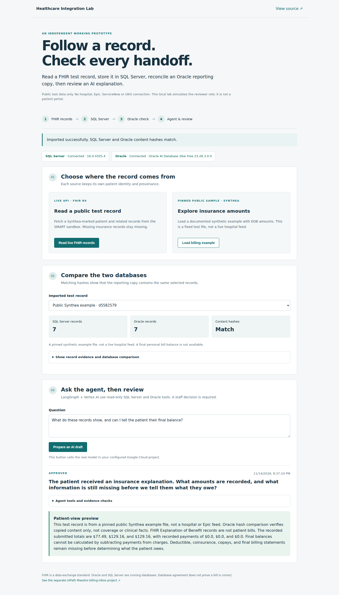
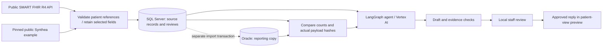

# Healthcare Integration Lab

An independent, runnable learning project by Lu Zhang: read FHIR test data, store it in **Microsoft SQL Server**, copy it to **Oracle Database Free**, verify the copy, and ask a **LangGraph-backed agent on Vertex AI** to prepare an explanation for human review.

This is an integration and evidence-handling demo using synthetic data. It is not affiliated with Mayo Clinic or connected to Epic, ServiceNow, UKG, or a hospital. The reviewer and patient preview share a local demonstration page; this project does not implement patient authentication or production SSO.



## What FHIR does here

FHIR is a standard format and API convention for exchanging healthcare information. It is not a database or an AI framework. This lab reads three kinds of FHIR R4 resources:

| Resource | What it contributes |
|---|---|
| `Patient` | A source-specific test-record ID |
| `Encounter` | Visits associated with that test record |
| `ExplanationOfBenefit` | Recorded insurance-processing amounts, when available |

An EOB is not a current patient bill. The app does **not** subtract payer payments from charges to infer what a patient owes.



Implementation detail: the importer writes the same validated snapshot to SQL Server and then Oracle, using separate transactions. There is no distributed transaction or change-data-capture service. If Oracle fails after SQL Server succeeds, the request reports failure and can be rerun without duplicating records.

## Run locally

Requires Docker with Linux containers, Python 3.11–3.13, [uv](https://docs.astral.sh/uv/), and enough memory for two database engines (the Compose file caps each at 3 GB). SQL Server uses its Developer edition for this development lab; Oracle uses its Free edition. Containers expose only loopback ports.

```bash
uv sync --frozen
uv run python scripts/setup_env.py
uv run python scripts/containers.py up
# Wait for both database engines to finish their first initialization.
uv run python scripts/bootstrap.py
uv run uvicorn app.main:app --host 127.0.0.1 --port 8780
```

Open **http://localhost:8780**. Database importing and reconciliation work without an LLM account. To run the AI button, configure `.env` with your Google Cloud project and an available Vertex model, then use Application Default Credentials, for example `gcloud auth application-default login`. Set `USE_GCLOUD_AUTH=true` only if you prefer the local developer's existing `gcloud` login. Credentials remain local; never commit `.env`.

`scripts/containers.py` supports native Docker and Docker Desktop from WSL. On macOS/ARM, use a supported x86-64 host for this SQL Server setup; this repository does not validate ARM emulation.

The databases retain data in project-specific volumes. `uv run python scripts/containers.py stop` stops only these two containers and preserves records. Start the app with one worker: its import/draft serialization is process-local.

## A three-minute demonstration

1. Click **Load billing example**. Show seven records in both databases and matching hashes.
2. Ask: **“The patient received an insurance explanation. What amounts are recorded, and what information is still missing before we tell them what they owe?”**
3. Click **Prepare an AI draft**, expand **Agent tools and evidence checks**, and show the actual SQL Server and Oracle tool results.
4. Edit if necessary and click **Approve reply**. The patient-view preview changes only after that decision. No external patient message is sent.
5. Select **Read live FHIR records** and run the same question. If that test patient has no EOB, the answer must say that insurance-payment information is unavailable.

## What is real, and what is simulated

| Component | Implementation |
|---|---|
| Live FHIR reads | Real HTTP GET requests to the public SMART R4 sandbox; fixed Synthea-marked patient; no remote writes |
| Billing example | Pinned public Synthea fixture, with recorded amounts; synthetic, not a live hospital feed |
| SQL Server | Real Microsoft container, bound queries, JSON functions, transactional imports, persisted reviews |
| Oracle | Real Oracle Free container, bound queries, CLOB JSON storage, JSON functions, grouped reporting counts |
| Agent | Real Vertex model calls via LangChain `create_agent`, which runs on LangGraph; two fixed-scope read-only tools |
| Staff review | Local application logic; persisted in SQL Server; no UiPath connection in this repository |
| Patient preview | Local preview of an approved response, not a separately authenticated patient portal |
| Epic / ServiceNow / UKG | Not connected; FHIR compatibility alone does not demonstrate Epic integration |

The separate [Revenue Cycle Agent](https://github.com/rockyzl/revenue-cycle-agent) project demonstrates real UiPath Maestro and Action Center integration. This lab concentrates on FHIR and relational databases.

## Boundaries and checks

- Identity is keyed by **source plus patient ID**. This avoids merging equal IDs from different sources; it is not an enterprise master-patient-index solution.
- Every imported Encounter/EOB must reference the selected patient. An unexpected patient reference, absent Patient, duplicate resource ID, or unexpected search resource type fails the import.
- Selected fields are projected into an internal record. Names, addresses, identifiers, and clinical narrative are not retained. These projections are **not complete FHIR resources for onward exchange**.
- Live imports are bounded to the first 30 records of each related type. A next-page link marks the snapshot incomplete; it is not silently presented as full history.
- Reimports replace the selected snapshot transactionally. Oracle and SQL Server payloads are hashed independently; stored hashes, counts, and the SQL snapshot manifest are checked.
- The agent cannot supply arbitrary SQL or a patient ID to its tools. Tools close over the selected test-record key.
- Draft checks require both tool outputs, exact evidence references, supported quoted dollar amounts, matching database copies, and an unchanged snapshot. These checks are deliberately limited; they do not prove every sentence is correct.
- Approval fails when checks fail, the source snapshot changed, or the case has already been reviewed. Rejection publishes no reply. Staff may edit the draft; that edit represents the human decision and is not a second LLM evaluation.
- This local lab has no production authentication, authorization, audit-integrity, or PHI compliance claim. Do not expose its port publicly or load real patient information.

## Verification

```bash
uv run pytest -q                              # unit/boundary checks, no cloud calls
RUN_DB_TESTS=1 uv run pytest -q                # includes real database checks
```

Database tests create their own temporary test-record scope and clean it up. They verify idempotence, parameterized lookups, altered Oracle content detection, failed-check rejection, repeat-review rejection, and stale-snapshot rejection. Live verification results are recorded in `reports/verification.json` when produced; CI does not claim to test external services.

The initial verified run passed **14 automated tests**, imported **7 fixture records** and **24 live test-server records** into both engines, and completed two real Vertex agent runs. Desktop/mobile browser checks verified English text, no horizontal overflow, and an approval still present after reloading. See [the verification record](reports/verification.json) and [interview notes](docs/interview-notes.md).

## Code map

| File | Responsibility |
|---|---|
| `app/fhir.py` | Source validation, patient references, reduced records, recorded financial facts |
| `app/databases.py` | SQL Server and Oracle adapters, import transactions, reconciliation, review state |
| `app/agent.py` | Vertex-backed agent, tools, structured response, evidence checks |
| `app/main.py` | Local FastAPI endpoints and operation serialization |
| `app/static/` | English demonstration page |
| `scripts/bootstrap.py` | Isolated application schemas and local application accounts |
| `data/provenance.json` | Exact upstream fixture revision, hashes, and transformation |

## Sources and attribution

The fixture is adapted from the Apache-2.0 licensed [Synthea project](https://github.com/synthetichealth/synthea). Its exact source commit and original/local hashes are in [data/provenance.json](data/provenance.json); the upstream license is preserved in [data/LICENSE-SYNTHEA.txt](data/LICENSE-SYNTHEA.txt). Original application code in this repository is MIT licensed.

Primary references: [HL7 FHIR overview](https://hl7.org/fhir/summary.html), [SMART public test servers](https://docs.smarthealthit.org/), [Microsoft SQL Server containers](https://learn.microsoft.com/en-us/sql/linux/quickstart-install-connect-docker?view=sql-server-ver16), [Oracle container documentation](https://github.com/oracle/docker-images/tree/main/OracleDatabase/SingleInstance).
